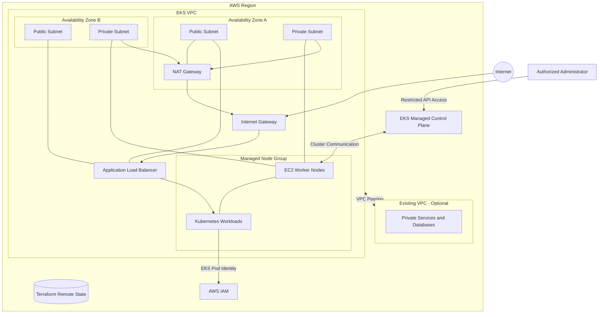
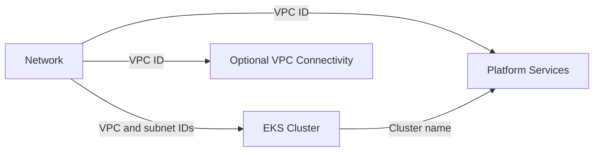
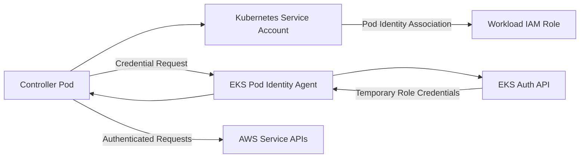

# Amazon EKS | Terraform Infrastructure


## Overview

A modular infrastructure-as-code implementation for provisioning and operating Amazon Elastic Kubernetes Service (EKS) using Terraform.

The architecture separates networking, cluster lifecycle, external connectivity, and Kubernetes platform services into independently managed infrastructure layers.

The implementation prioritizes:

- Infrastructure lifecycle isolation.
- Workload identity and scoped IAM permissions.
- Reproducible infrastructure provisioning.
- Explicit dependency management.
- Controlled infrastructure changes.
- Cost efficiency with a path toward higher availability.

## Architecture



The diagram represents the intended network topology. Worker placement depends on node group capacity, and application load balancers are provisioned dynamically when corresponding Kubernetes resources are created.

## Repository Structure

```text
eks/
├── terraform/
│   ├── network/
│   ├── cluster/
│   ├── connectivity/
│   └── platform/
│       └── policies/
├── .gitignore
└── README.md
```

| Layer | Responsibility |
|---|---|
| `network` | VPC, subnet topology, NAT gateways, routing and load balancer discovery tags |
| `cluster` | EKS control plane, managed node groups, access configuration and managed add-ons |
| `connectivity` | Optional VPC peering, bidirectional routing and DNS resolution |
| `platform` | Kubernetes controllers, Helm releases, IAM policies and EKS Pod Identity associations |

Each layer is an independent Terraform root module with its own backend configuration, provider constraints and dependency lock file.

## Infrastructure Dependencies



Dependencies between infrastructure layers are resolved through Terraform remote state outputs rather than hardcoded infrastructure identifiers.

## Architectural Decisions

### Independent Terraform State

Infrastructure is divided into separate state boundaries instead of a single monolithic Terraform configuration.

This allows networking, cluster infrastructure and platform services to follow different change lifecycles.

Benefits include:

- Reduced scope of individual infrastructure changes.
- Independent planning and validation.
- Clear ownership boundaries.
- Reduced coupling between infrastructure and platform operations.

The trade-off is increased dependency management complexity. Changes to upstream outputs must be coordinated with downstream configurations.

State isolation reduces the scope of changes but does not eliminate infrastructure dependencies or operational risk.

### Network Design

The VPC spans two availability zones, with public and private subnets in each zone.

Public subnets provide placement for internet-facing load balancers and NAT gateways. EKS managed worker nodes are provisioned in private subnets.

Subnet discovery tags allow the AWS Load Balancer Controller to identify suitable public and private subnets.

The default configuration uses a single NAT gateway to reduce operating costs. The NAT gateway topology is configurable to support one gateway per availability zone where availability requirements justify the additional cost.

### EKS Cluster Lifecycle

The EKS cluster uses AWS-managed control plane infrastructure and managed EC2 node groups.

Cluster configuration includes:

- Private and restricted public Kubernetes API endpoints.
- API-based IAM authentication.
- Cluster deletion protection.
- Control plane API and authenticator logging.
- Amazon Linux 2023 worker nodes.
- AWS-managed Kubernetes add-ons.
- Support for IRSA and EKS Pod Identity.

Managed add-ons include:

- Amazon VPC CNI
- CoreDNS
- kube-proxy
- EKS Pod Identity Agent

Managed node groups provide a foundation for controlled worker node lifecycle management and Kubernetes capacity scaling.

### Optional VPC Connectivity

VPC peering provides private connectivity between the EKS environment and an existing VPC.

This supports infrastructure migration and integration scenarios where applications depend on services hosted outside the Kubernetes VPC.

The connectivity layer manages:

- VPC peering connections.
- Bidirectional route table entries.
- Remote VPC DNS resolution.

The implementation assumes same-account, same-region VPC peering with non-overlapping IPv4 CIDR ranges.

Peering is non-transitive. Security groups, network ACLs, service-level permissions and DNS configuration must also permit the intended communication.

### Platform Services

Platform controllers are provisioned declaratively using the Terraform Helm provider.

| Component | Responsibility |
|---|---|
| AWS Load Balancer Controller | Reconciles supported Kubernetes networking resources into AWS load balancing infrastructure |
| Cluster Autoscaler | Adjusts managed node group capacity in response to Kubernetes scheduling requirements |
| EKS Pod Identity | Provides workload-specific AWS credentials without distributing static access keys |

Cluster Autoscaler deployment is configurable and can be disabled when a compatible release is unavailable.

## Security Architecture

### Workload Identity



Platform controllers receive temporary AWS credentials through EKS Pod Identity.

Dedicated IAM roles separate the permissions required by the AWS Load Balancer Controller and Cluster Autoscaler.

Cluster Autoscaler mutation permissions are restricted using resource tag conditions to limit scaling operations to appropriately tagged Auto Scaling groups.

### Security Controls

| Control | Purpose |
|---|---|
| AWS account allowlist | Prevents deployment into an unintended AWS account |
| Restricted public API CIDR | Limits public access to the Kubernetes API endpoint |
| Private worker subnets | Avoids direct public addressing of worker nodes |
| EKS Pod Identity | Avoids distributing long-lived AWS credentials to controllers |
| Dedicated IAM roles | Separates controller permissions |
| Cluster deletion protection | Reduces the risk of accidental cluster deletion |
| Remote state encryption | Protects Terraform state at rest |
| Native S3 state locking | Prevents conflicting Terraform state operations |

Terraform state access must be restricted independently through IAM and S3 bucket policies. Remote state consumers require access to the underlying state object, not only its declared outputs.

## Remote State Management

Each infrastructure layer maintains a dedicated S3 state object.

```text
S3 State Bucket
└── eks/
    ├── network/terraform.tfstate
    ├── cluster/terraform.tfstate
    ├── connectivity/terraform.tfstate
    └── platform/terraform.tfstate
```

Partial backend configuration separates environment-specific state settings from version-controlled Terraform configuration.

The state bucket must be provisioned separately with appropriate encryption, versioning, public access restrictions and IAM permissions.

Native S3 state locking is enabled through `use_lockfile`.

## Deployment

### Prerequisites

- Terraform >= 1.10 and < 2.0
- AWS CLI
- kubectl
- AWS credentials with appropriate provisioning permissions
- Existing S3 backend bucket
- An available EKS Kubernetes version in the target region

### Configuration

Each root module includes:

- `backend.hcl.example`
- `terraform.tfvars.example`

Create local configuration files:

```bash
cp backend.hcl.example backend.hcl
cp terraform.tfvars.example terraform.tfvars
```

Replace example values with environment-specific settings.

Ensure that remote state bucket names, regions and object keys remain consistent across dependent root modules.

### Deployment Order

1. Network
2. Cluster
3. Connectivity (optional)
4. Platform

From the relevant root module:

```bash
terraform init -backend-config=backend.hcl
terraform fmt -check
terraform validate
terraform plan -out=tfplan
```

Review the execution plan before applying:

```bash
terraform apply tfplan
```

Repeat for each infrastructure layer in dependency order.

### Kubernetes Access

After provisioning the cluster, generate a dedicated kubeconfig:

```bash
aws eks update-kubeconfig \
  --region ca-central-1 \
  --name eks-dev-cluster \
  --kubeconfig ~/.kube/eks-config
```

Verify the target cluster before provisioning platform services:

```bash
kubectl --kubeconfig ~/.kube/eks-config config current-context
kubectl --kubeconfig ~/.kube/eks-config cluster-info
kubectl --kubeconfig ~/.kube/eks-config get nodes
```

The kubeconfig path must match the platform Terraform configuration.

### Platform Verification

```bash
kubectl --kubeconfig ~/.kube/eks-config \
  get pods -n kube-system

kubectl --kubeconfig ~/.kube/eks-config \
  get deployment -n kube-system
```

Verify controller readiness, Pod Identity associations, IAM authorization and controller reconciliation before deploying dependent application workloads.

## Cost and Availability Trade-offs

The default configuration prioritizes development and testing costs.

| Component | Default | Higher-Availability Consideration |
|---|---|---|
| Availability zones | 2 | Distribute workloads across zones |
| NAT gateways | 1 | One per availability zone |
| Desired worker nodes | 1 | Multiple workers across zones |
| Node group minimum | 1 | Maintain sufficient redundant capacity |
| Node group maximum | 4 | Size according to workload requirements |
| Load Balancer Controller replicas | 1 | Multiple replicas |
| Cluster Autoscaler replicas | 1 | Evaluate supported leader-election configuration |
| Control plane log retention | 7 days | Align with operational and compliance requirements |

A multi-AZ network does not automatically make application workloads highly available.

Workload availability also depends on replica counts, scheduling constraints, disruption budgets, storage architecture and available node capacity.

## Operational Considerations

### Cluster Upgrades

Cluster upgrades should be treated as controlled infrastructure changes.

Before upgrading:

1. Review Kubernetes API deprecations.
2. Verify EKS add-on compatibility.
3. Verify controller and autoscaler compatibility.
4. Review managed node group upgrade behavior.
5. Evaluate workload disruption budgets.
6. Test changes in a non-production environment.

Cluster Autoscaler versions should align with the Kubernetes minor version.

### Infrastructure Changes

Review Terraform plans for unexpected resource replacement, deletion or changes to shared dependencies.

Changes to network outputs, cluster endpoints and IAM resources may require reconciliation of downstream infrastructure layers.

### Decommissioning

Infrastructure should be removed in reverse dependency order:

1. Application workloads and controller-managed load balancers.
2. Platform services.
3. Optional VPC connectivity.
4. EKS cluster.
5. Network.

Cluster deletion protection must be explicitly disabled before intentional cluster destruction.

Existing databases, external VPCs, shared services and the Terraform state bucket must be treated as separate lifecycle boundaries.

## Validation

The following static validation checks have been completed:

| Root Module | Terraform Format | Terraform Validate |
|---|---|---|
| Network | Passed | Passed |
| Cluster | Passed | Passed |
| Connectivity | Passed | Passed |
| Platform | Passed | Passed |

A repository-wide Gitleaks scan returned zero findings after downloaded Terraform dependencies were excluded from the publication directory.

Validation was performed without connecting to an existing remote state backend or provisioning AWS resources.

## Scope and Limitations

This repository is a generalized infrastructure reference implementation.

The current configuration has passed static validation, but end-to-end deployment of the generalized implementation has not been independently tested.

The following capabilities are outside the current implementation scope:

- Application deployment and GitOps reconciliation.
- Centralized observability and alerting.
- Automated infrastructure testing.
- Continuous integration and deployment pipelines.
- Disaster recovery automation.
- Comprehensive production security hardening.

These capabilities can be introduced independently without changing the core infrastructure separation.

## References

- [Amazon EKS Documentation](https://docs.aws.amazon.com/eks/)
- [Terraform AWS VPC Module](https://github.com/terraform-aws-modules/terraform-aws-vpc)
- [Terraform AWS EKS Module](https://github.com/terraform-aws-modules/terraform-aws-eks)
- [AWS Load Balancer Controller](https://github.com/kubernetes-sigs/aws-load-balancer-controller)
- [Kubernetes Cluster Autoscaler](https://github.com/kubernetes/autoscaler)
- [EKS Pod Identity](https://docs.aws.amazon.com/eks/latest/userguide/pod-identities.html)
- [Terraform S3 Backend](https://developer.hashicorp.com/terraform/language/backend/s3)
